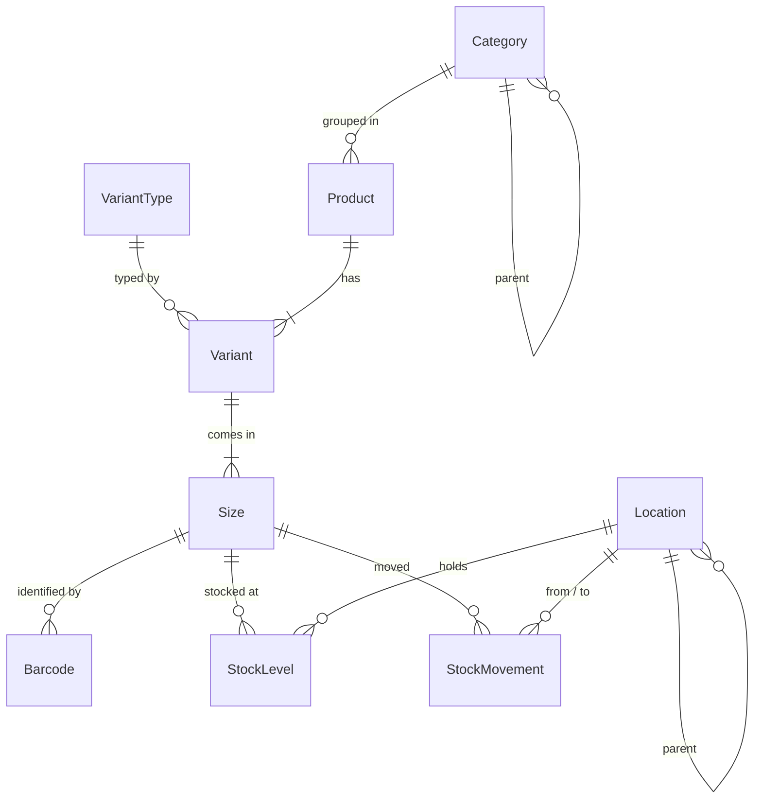

# Inventory Service – Technical Specification

## Overview

The **Inventory Service** owns the product catalog and stock for every tenant on the platform. It answers three questions: *what do we sell*, *how many do we have*, and *where is it*.

It is deliberately **domain-agnostic**. The first tenant is a garment wholesaler (products with sizes, HSN codes, barcodes), but the same service must hold electronics, raw materials, spare parts or anything else without a schema migration. This is achieved by promoting only universally needed fields to real columns and keeping everything tenant-specific in **`jsonb`** columns that are validated against a **per-tenant JSON Schema**.

The service is implemented in **NestJS with TypeScript**, mirrors the conventions of `auth-service`, and trusts the JWTs that service issues.

---

# Technology Stack

## Framework

* NestJS (TypeScript)

## Runtime

* Node.js

## Database

* PostgreSQL — **shared instance with auth-service**, separate Postgres schema (`inventory`)

## ORM

* Prisma 7 (`prisma-client` generator, `@prisma/adapter-pg` driver adapter)

## Validation

* class-validator (request DTOs)
* Ajv (tenant-defined JSON Schema for `attributes` / `options`)

## Messaging

* Kafka (stock events)

## Inter-service

* None at runtime. Access tokens are verified locally with auth-service's RS256 **public key** (`JWT_PUBLIC_KEY_PATH`, defaults to `../auth-service/keys/public.pem`). The gRPC `ValidateToken` in `libs/proto` returns a single role and no permissions, so it cannot drive the permission guard.

## Containerization

* Docker

## API Documentation

* Swagger (OpenAPI)

---

# Design Principles

## 1. Flexible by default, structured on demand

Every table carries a `jsonb` column for tenant-defined data. Only fields that need **indexing, uniqueness or foreign-key behaviour** are promoted to real columns.

| Column | Purpose |
| --- | --- |
| `attributes` | Tenant-defined data on a Product, Variant, Size, Category, Location, StockLevel |
| `payload` | Free-form context attached to a StockMovement |
| `metadata` | **Service** bookkeeping (source system, import ids, sync state). Never written by tenants, so tenant keys can never collide with ours |

## 2. Schema-driven editing

A **Product** has no type. It is a name, a code, tags, a description and whatever free-form `attributes` the tenant records on it (HSN code, brand, material…). Nothing validates those; they are the tenant's own key/value pairs.

A **VariantType** is the only catalog of types. Its `attribute_schema` is a JSON Schema for `Variant.attributes` — the fields a variant records (colour, finish, supplier code) — and `axis_key` names the **one** field among them whose values each get their own price and stock. Nothing about that field is special to us: it is "Size" for apparel, "Capacity" for bottles, "Pack" for multipacks, "Shade" for paint. If the field is a choice (`enum`) its choices are the only allowed values (strict); a plain text field allows any value. A type with no axis makes every variant a single stock unit.

Because the axis field's values live on the Sizes, it is stripped from the schema before `Variant.attributes` is validated.

Schemas carry an `x-order` list (builder field order; `jsonb` doesn't keep key order), may mark a string as `x-ui: "textarea"`, and mirror the axis as `x-axis` for the web builder. All are custom keywords the API's Ajv ignores.

The API validates writes against them with Ajv; the web UI renders create/edit forms from them. **Adding a field to a tenant's variants is a row update, not a migration.**

Example for the garment tenant:

```json
// variant type — Size splits stock, strictly
{ "key": "sized-apparel", "name": "Sized apparel",
  "attribute_schema": {
    "type": "object",
    "properties": {
      "colour": { "type": "string" },
      "size":   { "type": "string", "title": "Size", "enum": ["S", "M", "L", "XL"] }
    },
    "required": ["colour", "size"]
  },
  "axis_key": "size" }

// variant type — Capacity splits stock, any value
{ "key": "bottled", "name": "Bottled",
  "attribute_schema": { "type": "object", "properties": { "capacity": { "type": "string", "title": "Capacity" } } },
  "axis_key": "capacity" }

// variant type — one stock line per variant
{ "key": "single", "name": "Single item", "axis_key": null }
```

The API returns every variant type with its axis spelled out — `axis_label` (the field's title), `axis_values` (its choices) and `axis_free` — so clients never parse the schema for it.

## 3. Product → Variant → Size → Stock

* **Product** is the catalog entry. It never holds stock.
* **Variant** is a named version of the product — "Navy", "1001 BOYLEG", "Gift pack of 3" — with its own properties (validated by its VariantType). It never holds stock or prices either.
* **Size** is the stockable/sellable unit: one row per value of the variant type's axis field ("M", "500 ml", "12-pack"; "Default" for single-unit variants). The model is named Size for brevity; `label` is whatever the axis field is. Prices are here because each unit is priced on its own. Barcodes hang off sizes.
* **StockLevel** is the on-hand quantity of a size at a location. It is the single source of truth; totals are `SUM(quantity) GROUP BY size_id`, then summed per variant and per product.
* **StockMovement** is an append-only ledger. Every StockLevel change is written here in the same transaction.

Mapping from the legacy garment app (`justanidea`):

| Legacy | Inventory Service |
| --- | --- |
| `Products { name, HSN }` | `Product` with free-form `attributes.hsn` |
| `Variants { name }` ("1001 BOYLEG") | `Variant` with its `VariantType` (whose Size field splits stock) |
| `Variants.sizes[] { size, buyingPrice, sellingPrice, stock }` | One `Size` per entry with `label`, `cost_price`, `sell_price`; stock in `StockLevel` |
| `Variants.barcode` | `Barcode` rows on the size (many per size) |
| `Variants.supplierId` | `Variant.supplier_id` (loose reference to vendor-service) |
| `Inventory_logs` | `StockMovement` |

## 4. Multi-tenancy

Every table carries `tenant_id` (matches `auth-service` `Tenant.id`). All unique constraints are composite with `tenant_id`. There is **no foreign key** to tenants, suppliers or users: those live in other services and are stored as plain string references (`tenant_id`, `supplier_id`, `actor_id`).

## 5. One database instance, one schema per service

Budget allows a single Postgres instance. Each service owns a **Postgres schema (namespace)** inside the same database:

```
auth_service_db
├── public.*      ← auth-service
└── inventory.*   ← inventory-service
```

Prisma scopes migrations and drift detection to the schema named by `?schema=` on `DATABASE_URL`, so each service keeps its own `_prisma_migrations` table and its own `prisma/migrations/` history. The runtime adapter must be created with the same schema:

```ts
new PrismaPg(config, { schema: 'inventory' })
```

Moving a service to its own instance later is a `DATABASE_URL` change only.

---

# Database Schema

Database: PostgreSQL, schema `inventory`. Source of truth: [`prisma/schema.prisma`](../prisma/schema.prisma).



## variant_types

| column           | type             |
| ---------------- | ---------------- |
| id               | cuid (PK)        |
| tenant_id        | varchar          |
| key              | varchar          |
| name             | varchar          |
| description      | text nullable    |
| attribute_schema | jsonb (JSON Schema for `Variant.attributes`) |
| axis_key         | varchar nullable — key of the field in `attribute_schema` that splits stock; null = single unit |
| metadata         | jsonb            |
| created_at       | timestamp        |
| updated_at       | timestamp        |

Unique: `(tenant_id, key)`

---

## categories

| column      | type          |
| ----------- | ------------- |
| id          | cuid (PK)     |
| tenant_id   | varchar       |
| parent_id   | cuid nullable (self FK, Restrict) |
| slug        | varchar       |
| name        | varchar       |
| description | text nullable |
| attributes  | jsonb         |
| created_at  | timestamp     |
| updated_at  | timestamp     |

Unique: `(tenant_id, slug)`. Tree of arbitrary depth (Menswear > Innerwear > Briefs).

---

## products

| column          | type          |
| --------------- | ------------- |
| id              | cuid (PK)     |
| tenant_id       | varchar       |
| category_id     | cuid nullable (FK, SetNull) |
| code            | varchar nullable |
| name            | varchar       |
| description     | text nullable |
| status          | enum          |
| tags            | text[]        |
| attributes      | jsonb         |
| metadata        | jsonb         |
| created_at      | timestamp     |
| updated_at      | timestamp     |
| deleted_at      | timestamp nullable (soft delete) |

Status values:

```
DRAFT
ACTIVE
INACTIVE
ARCHIVED
```

Unique: `(tenant_id, code)`
Indexes: `(tenant_id, status)`, `(tenant_id, category_id)`, GIN on `attributes` (jsonb_path_ops), GIN on `tags`.

---

## variants

| column          | type          |
| --------------- | ------------- |
| id              | cuid (PK)     |
| tenant_id       | varchar       |
| product_id      | cuid (FK, Cascade) |
| variant_type_id | cuid nullable (FK, SetNull) |
| name            | varchar       |
| status          | enum (same as products) |
| supplier_id     | varchar nullable (vendor-service reference) |
| sort            | int (order entered) |
| attributes      | jsonb (validated by the variant type) |
| metadata        | jsonb         |
| created_at      | timestamp     |
| updated_at      | timestamp     |
| deleted_at      | timestamp nullable |

Unique: `(tenant_id, product_id, name)`
Indexes: `(product_id)`, `(tenant_id, variant_type_id)`, GIN on `attributes`.

---

## variant_sizes (model `Size`)

| column     | type          |
| ---------- | ------------- |
| id         | cuid (PK)     |
| tenant_id  | varchar       |
| variant_id | cuid (FK, Cascade) |
| label      | varchar ("M", "500 ml", "Default") |
| sku        | varchar nullable |
| cost_price | decimal(18,4) nullable |
| sell_price | decimal(18,4) nullable |
| currency   | varchar (default `INR`) |
| unit       | varchar (default `pcs`) |
| sort       | int           |
| attributes | jsonb         |
| metadata   | jsonb         |
| created_at | timestamp     |
| updated_at | timestamp     |
| deleted_at | timestamp nullable |

Unique: `(tenant_id, sku)`, `(variant_id, label)`
Indexes: `(variant_id)`, `(tenant_id, deleted_at)`.

Migration `20260918160000_variant_types_and_sizes` turned every old stock-unit row into one Variant (its name) holding one Size (label from `options.size`, else "Default"); old ids were kept as the Size ids so stock, movements and barcodes only had their FK column renamed.

---

## barcodes

| column     | type        |
| ---------- | ----------- |
| id         | cuid (PK)   |
| tenant_id  | varchar     |
| size_id    | cuid (FK, Cascade) |
| value      | varchar     |
| type       | enum        |
| is_primary | boolean     |
| metadata   | jsonb       |
| created_at | timestamp   |

Unique: `(tenant_id, value)` — lookup by scanned value is the hot path.

Type values:

```
CODE128 CODE39 CODE93 EAN13 EAN8 UPC_A UPC_E
QR_CODE DATA_MATRIX PDF417 AZTEC CODABAR ITF CUSTOM
```

---

## locations

| column      | type          |
| ----------- | ------------- |
| id          | cuid (PK)     |
| tenant_id   | varchar       |
| parent_id   | cuid nullable (self FK, Restrict) |
| code        | varchar       |
| name        | varchar       |
| description | text nullable |
| is_default  | boolean       |
| attributes  | jsonb         |
| created_at  | timestamp     |
| updated_at  | timestamp     |

Unique: `(tenant_id, code)`. Tree: warehouse → zone → shelf → bin. Every tenant gets one `is_default` location seeded on creation so single-site tenants never have to choose one.

---

## stock_levels

| column      | type          |
| ----------- | ------------- |
| id          | cuid (PK)     |
| tenant_id   | varchar       |
| size_id     | cuid (FK, Cascade) |
| location_id | cuid (FK, Restrict) |
| quantity    | decimal(18,4) |
| reserved    | decimal(18,4) |
| reorder_at  | decimal(18,4) nullable |
| attributes  | jsonb         |
| created_at  | timestamp     |
| updated_at  | timestamp     |

Unique: `(size_id, location_id)`. `available = quantity - reserved`.

---

## stock_movements

| column           | type          |
| ---------------- | ------------- |
| id               | cuid (PK)     |
| tenant_id        | varchar       |
| size_id          | cuid (FK, Cascade) |
| type             | enum          |
| quantity         | decimal(18,4) |
| from_location_id | cuid nullable (FK, SetNull) |
| to_location_id   | cuid nullable (FK, SetNull) |
| actor_id         | varchar nullable (auth-service user id) |
| reference_type   | varchar nullable (`order`, `purchase`, `stock_take`…) |
| reference_id     | varchar nullable |
| reason           | text nullable |
| payload          | jsonb         |
| occurred_at      | timestamp     |
| created_at       | timestamp     |

Type values:

```
IN        to_location required
OUT       from_location required
ADJUST    exactly one location; quantity may be negative
TRANSFER  both locations required
```

Indexes: `(tenant_id, occurred_at)`, `(size_id, occurred_at)`, `(tenant_id, reference_type, reference_id)`.

Rows are **never updated or deleted**. Corrections are new `ADJUST` movements.

---

# Stock Flows

## Receive stock (IN)

1. Client posts movement `{ size_id, type: IN, quantity, to_location_id, reference }`
2. Service validates variant + location belong to the tenant
3. In one transaction: upsert `stock_levels` (+quantity), insert `stock_movements`
4. Event published: `inventory.stock.changed`

## Issue stock (OUT)

Same as IN with `from_location_id`; fails with `409` if `available < quantity` unless `allow_negative` is set on the tenant.

## Transfer

Two `stock_levels` rows updated (−from, +to) and one `TRANSFER` movement, all in one transaction.

## Reserve / release

`reserved` is adjusted without touching `quantity`. Used by transaction-service while an order is open. No movement row is written; reservations are not stock changes.

## Stock take (ADJUST)

Client posts the counted quantity; the service computes the delta, writes an `ADJUST` movement with `payload.counted` and `payload.previous`, and sets `quantity` to the counted value.

---

# Kafka Events

**Not implemented yet.** auth-service has no Kafka producer either, so this is shared infrastructure to add once a consumer exists. The design below is what the service will publish.

Topics published:

```
inventory.product.created
inventory.product.updated
inventory.product.deleted
inventory.variant.created
inventory.variant.updated
inventory.stock.changed
inventory.stock.low
```

Example event:

```json
{
  "event": "inventory.stock.changed",
  "tenantId": "tenant123",
  "variantId": "clx...",
  "locationId": "clx...",
  "movementId": "clx...",
  "type": "OUT",
  "quantity": "3",
  "balance": "42",
  "timestamp": "2026-09-18T10:00:00Z"
}
```

`inventory.stock.low` fires when `quantity` crosses below `reorder_at`.

Consumers may include:

* transaction-service (order fulfilment)
* notification-service (low-stock alerts)
* analytics-service
* audit-service

---

# API Endpoints

All routes require a Bearer JWT from auth-service. `tenant_id` is taken from the token, never from the request body.

```
# Variant types (variant fields + how they are stocked)
GET    /variant-types
POST   /variant-types            { key, name, attribute_schema?, axis_key? }   (response adds axis_label / axis_values / axis_free)
GET    /variant-types/:id
GET    /variant-types/:id/violations
PATCH  /variant-types/:id
DELETE /variant-types/:id        (409 while variants use it)

# Categories
GET    /categories
POST   /categories
PATCH  /categories/:id
DELETE /categories/:id

# Products
GET    /products                 ?q= &status= &category= &tag= &attr[hsn]=6107
POST   /products                 { ..., variants: [{ name, variant_type_id?, attributes?, sizes?: [{ label?, sku?, cost_price?, sell_price?, barcodes? }] }] }
GET    /products/:id             (variants → sizes → stock, with totals at every level)
PATCH  /products/:id
DELETE /products/:id             (soft delete, cascades to variants and sizes)

# Variants
GET    /products/:id/variants
POST   /products/:id/variants    (same shape as one entry of variants[] above)
GET    /variants/:id
PATCH  /variants/:id             (name, attributes, variant_type_id — a new type must accept every live size)
DELETE /variants/:id             (409 for the last variant of a product)

# Sizes (the stock units)
POST   /variants/:id/sizes       { label, sku?, cost_price?, sell_price? }  — label must be on the type's list; 400 for single-unit types
GET    /sizes/lookup?barcode=    (scan path → size with its variant and product)
GET    /sizes/:id
PATCH  /sizes/:id                (prices, sku, label; null clears a price)
DELETE /sizes/:id                (409 for the last size of a variant)

# Barcodes
POST   /sizes/:id/barcodes
DELETE /barcodes/:id

# Locations
GET    /locations
POST   /locations
PATCH  /locations/:id
DELETE /locations/:id

# Stock
GET    /stock                    ?size= &variant= &product= &location= &below_reorder=true
GET    /sizes/:id/stock          (per-location breakdown + total)
POST   /stock/movements          { size_id, type: IN / OUT / ADJUST / TRANSFER, ... }
GET    /stock/movements          ?size= &variant= &product= &location= &reference= &from= &to=
POST   /stock/reserve
POST   /stock/release
```

Required permissions (from the auth-service RBAC model):

```
inventory.read
inventory.write      (products, variants, categories, reserve/release, reorder points)
inventory.adjust     (stock movements)
inventory.admin      (product types, locations)
```

auth-service does not seed permission rows yet, so tokens carry roles but an empty `permissions` array. The guard therefore treats the `owner` and `admin` roles as full access and checks the list above for everyone else. Remove that bypass once permissions are seeded.

---

# Validation Rules

* `Product.attributes` is free-form — anything the tenant records.
* `Variant.attributes` must satisfy its own `VariantType.attribute_schema` (minus the axis field) when a type is set. Variants of one product may use different types.
* `name` is mandatory on every variant and unique among a product's live variants.
* A product must have at least one variant; a variant must have at least one size.
* **The axis field decides the sizes.** With a typed variant whose type has an axis, the variant must list at least one value; when the axis field is a choice, every `Size.label` must be one of its choices (strict); when it is text, any label goes. A single-unit type gets exactly one size labelled `Default`; an untyped variant may use any labels (none given → one `Default`). Changing a variant's type re-checks its live sizes. Shrinking a choice list is allowed; sizes left outside it are reported by `GET /variant-types/:id/violations`. The axis must be a text or choice field.
* `cost_price` and `sell_price` live on the size because each size is priced on its own. They are **optional** — a size can be created without them and priced later (`PATCH /sizes/:id`; `null` clears).
* A location with children or non-zero stock cannot be deleted.
* A variant type in use cannot be deleted; its schema may be changed but existing rows are **not** re-validated (report drift via `GET /variant-types/:id/violations`).

---

# NestJS Module Architecture

```
src
 ├ modules
 │  ├ categories
 │  ├ products                 (+ product-schema.service.ts: resolves a type, validates attributes/options)
 │  ├ variant-types            (CRUD + violations)
 │  ├ variants                 (variants, sizes, barcodes, /sizes/lookup)
 │  ├ locations                (tree, lazily created default location)
 │  └ stock                    (levels, ledger, reserve/release, reorder points)
 │
 ├ auth
 │  ├ auth.module.ts           (JwtModule with auth-service's public key)
 │  ├ guards/                  (JwtAuthGuard requires tenant_id; PermissionsGuard)
 │  ├ decorators/              (@Tenant, @CurrentUser, @RequirePermissions, Perm)
 │  └ protected.decorator.ts   (@Protected(perm) = both guards)
 ├ prisma
 │  ├ prisma.service.ts        (adapter created with { schema: 'inventory' })
 │  └ connection-config.ts     (copied from auth-service)
 ├ common
 │  ├ json-schema.validator.ts (Ajv wrapper, compiled-schema cache)
 │  ├ stock-summary.ts         (per-variant totals)
 │  ├ prisma-errors.ts         (P2002 -> 409, P2025 -> 404)
 │  └ json.decorator.ts        (@IsJsonObject for jsonb DTO fields)
 ├ health.controller.ts
 └ main.ts                     (Express "extended" query parser for attr[key]=value)
```

Raw SQL is used in exactly two places, both in `stock.service.ts`: the `SELECT ... FOR UPDATE` row lock inside movement transactions, and the `quantity - reserved < reorder_at` scan behind `below_reorder`.

---

# Infrastructure Dependencies

* PostgreSQL (shared instance, `inventory` schema)
* auth-service's `keys/public.pem` for token verification
* Kafka broker (future)
* Docker container runtime

---

# Web UI (`web/`)

Routes under `/inventory`, all server-rendered with server actions; tokens never leave httpOnly cookies (same pattern as `lib/auth`):

| Route | What it does |
| --- | --- |
| `/inventory` | Product list with search (name, code, variant name, SKU, barcode), variant/size counts, stock totals, and a "New product" sheet |
| `/inventory` → New product | Name, code, tags and free-form **Properties** (key/value rows — HSN code, brand…), then a list of variant cards. After a create the sheet stays open with an empty form and a "created — open it" notice, so several products can be entered in a row. Each card is the legacy layout: **variant name**, its **variant type**, the type's fields, and a **sizes table** (Size · Cost price · Sell price · SKU). The column is named after the type's axis field (Size, Capacity…): a choice field gives toggle chips, a text field a "250 ml, 1 l" bulk-add box; a type without an axis shows one row; an untyped variant takes free labels |
| `/inventory/[id]` | One block per variant (name, type, properties, totals) with its sizes table — per-size prices, barcode, on-hand/reserved, per-location breakdown, "Move" sheet — an "Add size" row offering only the unused sizes of the type, and an "Add a variant" form using the same card. Recent ledger and editable product details below |
| `/inventory/activity` | Full ledger plus everything below its reorder point, each row naming variant · size · SKU |
| `/inventory/variant-types` | The only type catalog. A sheet with the built-in columns listed (Name required; cost/sell price, SKU, barcode optional, per value) and a **field builder** — one row per field (name, type, required, **Splits stock**; keys auto-derived and hidden). Ticking *Splits stock* on a field (only one; text or choice) makes its values the separately priced stock lines. A "Stock split" group in the common-fields palette (Size, Capacity, Pack size, Length, Voltage, Grade) and five templates seed it; JSON Schema is generated, never typed by hand |
| `/inventory/locations` | Location tree and default location |

Camera scanning lives in `lib/barcode/decoder.ts` (the browser's `BarcodeDetector` when present, `@zxing/browser` otherwise — both decode frames from one `<video>` owned by `hooks/use-barcode-scanner.ts`) and `components/inventory/scanner/`: `CameraScanner` is the viewfinder, `ScanButton` opens it in a bottom sheet and returns one code, `BarcodeInput` pairs it with an uncontrolled input so every "scan or type" field (assign barcode, size rows, the Move stock picker) accepts a phone camera; the header's **Scan** button opens the same sheet and lands on Move stock. The camera needs a secure context — HTTPS or localhost.

`lib/inventory/schema-builder.ts` converts between the builder's field list and JSON Schema in both directions; a schema that uses constructs the builder can't express falls back to a raw JSON editor. `components/inventory/schema-fields.tsx` renders a variant type's schema (minus its axis field) as real inputs (number, choice, yes/no, date) and posts `vattr[key]` values that the server coerces to the right JSON types before calling the API; with no schema — product properties, untyped variants — it offers free-form key/value rows instead.

If inventory-service is down, each panel shows a notice and the rest of the app keeps working.

---

# Scope Boundaries

This service does **not** own:

* orders, invoices, pricing rules → transaction-service
* suppliers / purchase orders → vendor-service
* customers → customer-service
* users, tenants, roles → auth-service

It stores only loose string references to those entities.

---

# Future Enhancements

* Batch / lot and expiry tracking (`stock_levels` keyed by `(variant, location, lot)`)
* Serial-number tracking for high-value items
* Computed attributes (formula fields in `attribute_schema`)
* Bulk import (CSV) with schema validation report
* Full-text search over `name` + `attributes`
* Unit-of-measure conversions (`box` = 12 × `pcs`)

---

# Responsibilities of Inventory Service

The inventory service manages:

* per-tenant product type definitions (JSON Schema)
* product catalog and categories
* variants, prices and barcodes
* locations
* stock levels and the movement ledger
* stock events for the rest of the platform
